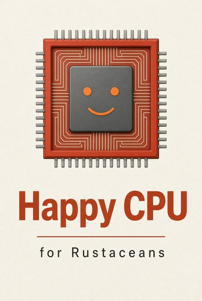

# Happy CPU for Rustaceans

**Your Rust is half the performance story. The other half is what the compiler turns it into — and whether that code lets the CPU go as fast as it can. This book is about designing for both**

## 📖 Download the book

**[happy-cpu-for-rustaceans.pdf](https://github.com/m-javani/happy-cpu-book/releases/latest/download/happy-cpu-for-rustaceans.pdf)** — free, no signup.

## About the book

You can write clean Rust, choose the right data structures, and follow
every best practice — and still end up with a program that's slower
than it should be. The reason is usually that the machine isn't doing
what you think it's doing.

The compiler is a smart optimizer. The CPU is a fast machine. Neither
one is on your side by default — they execute what you gave them, not
what you meant. The gap between the two is where performance lives.

This book is about the layers between your Rust source and the
hardware that runs it: caches and memory layout, cache coherence, the
TLB, the CPU pipeline, SIMD, the allocator, the kernel boundary, and
the compiler. Each chapter explores one of these layers, explains what
the machine is actually doing, and shows what you can do about it.

The chapters are short, and each ends with an exercise. The tools are
introduced where they're useful, not as a manual. By the end, you'll
be able to look at a slow program and know where to look next.

**Fourteen short chapters and a case study.** Each chapter is meant to
be readable in a sitting, and each one ends with a practical exercise.

- **Chapters 2–4** — memory: cache hierarchy, data layout, temporal locality
- **Chapters 5–7** — the multicore machine: false sharing, address translation, NUMA
- **Chapters 8–10** — the core itself: the pipeline, top-down analysis, SIMD and auto-vectorization
- **Chapters 11–14** — everything else: allocation, zero-copy, I/O and syscalls, and the compiler
- **Chapter 15** — a full worked case study: three layouts of a sparse matrix-vector multiply, measured and profiled

The book assumes you know Rust and want your programs to be fast. It
doesn't assume you know assembly, microarchitecture, or systems
programming. Where tools are useful (`perf`, `cargo asm`, `strace`),
they're introduced briefly and used to answer a specific question.

## Companion code

Every chapter has a runnable example in its own directory. Copy the
`main.rs` into a fresh `cargo new` project and `cargo run --release`.

See **[CODE.md](CODE.md)** for the full index.

## Feedback

If you find a typo, a technical mistake, or a place where the
explanation could be clearer, please [open an
issue](https://github.com/m-javani/happy-cpu-book/issues). Corrections
are collected and appear in the next release.

## License

The book is licensed under [CC BY
4.0](https://creativecommons.org/licenses/by/4.0/). The companion code
is licensed under [MIT](https://opensource.org/license/mit).

